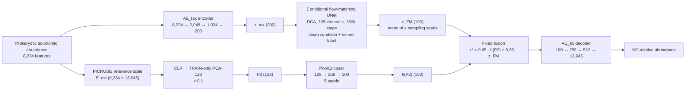

# TaxoFunc

**Predicting KEGG ortholog abundance from prokaryotic taxonomy with a conditional generative model.**

TaxoFunc is a research code release for translating a prokaryotic taxonomic
abundance profile into a KEGG Ortholog (KO) relative-abundance profile. The
released model, **TaxoFunc-P2FM-ens-v2**, combines two complementary estimators
in a fixed latent ensemble:

1. a conditional **flow-matching** model over independently trained
   autoencoder latents, and
2. a **PICRUSt2-derived prior encoder** that maps a fixed taxon-to-KO reference
   table to the same KO latent space.

The two 100-dimensional estimates are fused with a fixed weight (not learned
inside the network) and decoded by a frozen KO autoencoder decoder. The fusion
weight and the prior-encoder configuration were selected on the validation split;
see [Limitations](#limitations).

> **Release scope.** This repository contains curated source code and
> validation-split summary metrics for `TaxoFunc-P2FM-ens-v2`. It does **not**
> contain held-out evaluation results, external-cohort results, raw metagenomic
> data, model weights, or training logs. It is **not** a turnkey end-to-end
> reproduction package; see [What is not included](#what-is-not-included).

---

## Contents

- [Scientific question](#scientific-question)
- [Data at a glance](#data-at-a-glance)
- [Model](#model)
- [Training](#training)
- [Evaluation](#evaluation)
- [Results on the validation split](#results-on-the-validation-split)
- [Repository structure](#repository-structure)
- [Installation](#installation)
- [Running the code](#running-the-code)
- [What is not included](#what-is-not-included)
- [Limitations](#limitations)
- [License status](#license-status)
- [Third-party code](#third-party-code)
- [References](#references)

---

## Scientific question

Shotgun metagenomics measures both taxonomic composition and functional
potential, but large-scale surveys often have 16S rRNA or other taxonomic
profiles without matched functional profiles. A practical question is:

> Given only the prokaryotic taxonomic composition of a sample, how much of its
> KEGG KO profile can be predicted, and can a conditional generative model learn
> the joint structure of thousands of KOs rather than treating each KO as an
> independent regression target?

TaxoFunc addresses this as a **cross-modal conditional generation** problem.
The input is an 8,234-dimensional prokaryotic taxon-count vector; the output is
a 13,945-dimensional KO relative-abundance vector. The model is evaluated with
feature-level Spearman correlation on a study-grouped validation split.

---

## Data at a glance

| Item | Value |
|---|---|
| Source | MGnify paired taxonomic and KO functional profiles |
| Taxonomic scope | Bacteria + Archaea only (prokaryotic) |
| Taxon features | 8,234 multi-rank taxon features |
| KO features | 13,945 KOs in the common KO space |
| Samples | 23,951 paired samples after removing degenerate rows |
| Studies | 619 |
| Split | Study-grouped (L2). The 14,861 flow/prior training rows and the 3,098 validation samples are study-disjoint; the AE pretraining set (17,959) includes the validation studies. |
| L2 training rows | 17,959 (includes the 99 validation studies) |
| Validation samples | 3,098 from 99 held-out studies (subset of the 17,959 L2 training rows) |
| Scoring mask | 5,610 KOs with training prevalence ≥ 10% |

The three headline counts are not disjoint: the 3,098 validation samples are a
subset of the 17,959 L2 training rows, and the flow/prior models use the
remaining 14,861 rows. The total of 23,951 also includes a further partition
that is not described in this release.

Raw data are **not redistributed** in this repository. See
[`docs/DATA.md`](docs/DATA.md) for the data description and access notes.

---

## Model

### Overview



### Generative branch

Two autoencoders are trained independently:

- `AE_tax`: `8,234 → 2,048 → 1,024 → 200`, Poisson likelihood for taxon counts.
- `AE_ko`: `13,945 → 1,024 → 512 → 100`, negative-binomial likelihood for KO
  counts; decoder `100 → 256 → 512 → 13,945`.

The decoder width is decoupled from the encoder mirror. Both decoders use a
softmax over features multiplied by the observed sample size factor, so depth is
handled outside the latent representation.

A class-conditional flow-matching UNet is then trained on the frozen latents:

```text
z_tax = E_tax(x_tax) / atac_std
z_ko  = E_ko(x_ko) / rna_std

u     = 10 · z_ko
u_t   = (1 − t) · ε + t · u,        ε ~ N(0, I),  t ~ U[0, 1)
loss  = || (u − ε) − v_θ(u_t, t | z_tax, biome) ||²
```

The taxonomic condition is kept **clean** at every flow time. The UNet retains
the dual cross-attention (DCA) blocks from scDiffusion-X, so information can flow
in both directions between the KO and taxonomy token streams. At inference,
1,000 Euler steps integrate the learned velocity field from Gaussian noise to the
KO latent. Four independent sampling seeds are averaged (`avg4`).

### Prior branch

A fixed PICRUSt2 taxon-to-KO table is used as an external functional prior:

```text
P_ext   = row-normalised PICRUSt2 taxon → KO table       (8,234 × 13,945)
P       = A_rel @ P_ext
L       = log(P + 1e-6);   L -= mean(L)
P2      = ((L − TRAIN_mean) @ TRAIN_components) / TRAIN_scale   (128-d)
h(P2)   = PriorEncoder(128 → 256 → 100)                  (GELU, LayerNorm)
```

The PCA basis and scaling statistics are fitted on the training split only. The
prior encoder is trained on the 128-dimensional P2 block to predict the
standardised KO latent. The released configuration averages five training seeds
(`42, 7, 123, 2024, 99`).

`P2` is a **functional prior input**, not a separately reported prediction arm.
It is one of the two estimators in the released ensemble.

### Fixed fusion

```text
z* = 0.65 · h(P2) + 0.35 · z_FM
y  = softmax(D_ko(z* · rna_std)) · size_factor
```

The fusion weight is fixed in the released model and is not learned inside the
network. However, the cfg11 PriorEncoder configuration and the fusion weight
`α=0.35` were selected on the validation split during model development. The
validation metrics therefore include a hyperparameter-selection bias and are
optimistic relative to an unbiased estimate on a new cohort.
`TaxoFunc-P2FM-ens-v2` is an **explicit two-estimator ensemble**, not a single
end-to-end graph.

---

## Training

| Stage | Data | Configuration |
|---|---|---|
| AE | 17,959 L2 training rows | 300 epochs, lr 3e-4, wd 1e-4, batch 256, Poisson/NB likelihood |
| Flow matching | 14,861 rows (99 validation studies removed) | 180,000 steps, batch 128, lr 1e-4, EMA 0.9999, 1,000 diffusion steps |
| PriorEncoder | 14,861 training rows | cfg11: lr 5e-4, 200 epochs, batch 256, dropout 0.1, z-scored P2; 5 seeds |

The flow model and the prior encoder never see the 3,098 validation samples
during fitting. Their training weights are fit on the 14,861 rows; their
configurations were selected on the validation split, as noted under Limitations.
The AE (`final_s2`) was pretrained on the 17,959 L2 training rows, which include
the validation studies; absolute validation scores are therefore optimistic.
This caveat is carried through the model card and evaluation notes.

The released source code includes the AE training entry, the flow-matching
training entry, the P2 block builder, the inference entries, and the model
definition. See [`docs/METHOD.md`](docs/METHOD.md) and
[`docs/REPRODUCIBILITY.md`](docs/REPRODUCIBILITY.md).

---

## Evaluation

All reported numbers are computed on the **validation split**:

- 3,098 samples from 99 held-out studies; 64 studies have at least two samples
  and are used for per-study medians.
- The primary metric is **feature-level Spearman correlation** on raw truth.
- **Pooled** score: for each KO, Spearman across samples; median over the 5,610
  scored KOs.
- **Per-study median**: for each study, Spearman across samples for each KO,
  median over KOs; then median over studies.
- `n≥4` is the subset of studies with at least four samples.
- MGFunc and PICRUSt2 are **validation-benchmark comparators**, not external
  validation of TaxoFunc.

The evaluation protocol is described in [`docs/EVALUATION.md`](docs/EVALUATION.md).
Per-study paired test statistics are withheld from this release.

---

## Results on the validation split

The table below is a summary of the released validation metrics. The full table,
with all baselines, is in
[`results/val_benchmark_20261106_public.tsv`](results/val_benchmark_20261106_public.tsv).

| Method | Family | Input | Pooled | Per-study median (64 studies) | Per-study median (n≥4) |
|---|---|---|---:|---:|---:|
| **TaxoFunc-P2FM-ens-v2** | model | raw taxa + P2 + AE + flow matching | **0.6952** | **0.3197** | **0.3188** |
| Ridge (raw taxa) | traditional ML (end-to-end) | raw taxa only | 0.4740 | 0.2320 | 0.2236 |
| RandomForest 300 | traditional ML (end-to-end) | raw taxa only | 0.5100 | 0.2024 | 0.2047 |
| MLP 256 (raw taxa) | traditional ML (end-to-end) | raw taxa only | 0.3462 | 0.1096 | 0.1074 |
| PICRUSt2 prior (B4) | validation benchmark baseline | PICRUSt2 prior | 0.4292 | 0.1997 | 0.1853 |
| MGFunc (B5) | validation benchmark baseline | MGFunc | 0.4094 | 0.1845 | 0.1772 |

**How to read this table.** TaxoFunc uses the PICRUSt2 prior and the frozen AE
decoder; the traditional-ML rows use raw taxon relative abundance only and no
model latent or decoder; PICRUSt2 and MGFunc are prior/tool baselines. These are
different families of predictors, so cross-family comparisons are descriptive.
Only the validation split is reported. Absolute TaxoFunc scores are optimistic
because the AE pretraining corpus included the validation studies.

---

## Repository structure

```text
TaxoFunc/
├── README.md
├── LICENSE_STATUS.md
├── THIRD_PARTY_NOTICES.md
├── requirements.txt
├── .gitignore
├── docs/
│   ├── METHOD.md
│   ├── MODEL_CARD.md
│   ├── DATA.md
│   ├── EVALUATION.md
│   ├── REPRODUCIBILITY.md
│   └── figures/README.md
├── results/
│   ├── README.md
│   └── val_benchmark_20261106_public.tsv
├── taxofunc/
│   ├── models/TaxoFunc-P2FM-ens-v2/h_model.py
│   ├── build_p2_block.py
│   └── ...
└── models/scdiffusion_x/
    ├── py/                 # project patches and training/inference entries
    ├── configs/            # AE and flow-matching configurations
    └── upstream/           # vendored scDiffusion-X source (MIT + BSD-3-Clause; see notices)
```

`models/scdiffusion_x/upstream/` contains the vendored upstream scDiffusion-X
source used as the network backbone. One cluster-specific default path was made
relative; no other upstream source change was made. The project-specific changes
are monkey-patches in `models/scdiffusion_x/py/`:

- `mgm_patch.py` — numerical rate-floor guard for Poisson / negative-binomial
  likelihoods.
- `ae_v2_patch.py` — encoder input parameterization and decoupled decoder.
- `flow_objective_patch.py` — linear flow-matching objective with a clean
  taxonomic condition.
- `flow_sampler_patch.py` — 1,000-step Euler sampler that keeps the condition
  clean.

The vendored upstream code retains its upstream MIT (top-level) and BSD-3-Clause
(package) license texts. The exact coverage boundary is pending confirmation;
see [`THIRD_PARTY_NOTICES.md`](THIRD_PARTY_NOTICES.md).

---

## Installation

The original research environment used Python 3.8.20. The dependency
constraints are listed in [`requirements.txt`](requirements.txt).

```bash
python -m venv .venv
source .venv/bin/activate
pip install -r requirements.txt
export PYTHONPATH="$PWD/models/scdiffusion_x/upstream/scdiffusionX/src:$PYTHONPATH"
```

`mpi4py` requires a working MPI implementation (for example OpenMPI or MPICH).
`torch==2.4.1` should be installed as the CUDA 12.1 build for GPU training and
inference; the default PyPI wheel may be CPU-only. A CUDA-capable GPU is required
for flow-matching training and inference. The P2 block builder and the data
utilities can run on CPU.

---

## Running the code

The repository is a **code release**, not a self-contained reproduction package.
The data and model assets listed in
[`docs/REPRODUCIBILITY.md`](docs/REPRODUCIBILITY.md) are required.

```bash
# AE training (configuration from the released recipe)
bash models/scdiffusion_x/configs/ae_final_train.sh 0 2

# Flow-matching training
bash models/scdiffusion_x/configs/df_flow_full.sh 0

# P2 prior block
python taxofunc/build_p2_block.py --out-dir taxofunc/cache/side_p2

# Flow-matching inference for one sampling seed
STEP=180000 SAMPLE_SEED=0 bash models/scdiffusion_x/configs/translate_flow.sh
```

---

## What is not included

This release intentionally does **not** contain:

- MGnify raw or processed data, derived count matrices, or split manifests.
- Model weights, checkpoints, flow samples, or frozen latent caches.
- Training logs, experiment logs, preregistrations, internal audits, or
  laboratory records.
- Held-out evaluation results or external-cohort results.
- Publication figures; these are withheld pending laboratory authorization.
- The internal ensemble-assembly script and the project's non-public training
  and audit scripts.
- A project license (see below).

Consequently, the repository cannot reproduce the reported numbers end to end.
It provides the model code, the released configuration, the P2 construction
logic, and the validation summary table so that the method and reported
validation metrics can be inspected.

---

## Limitations

- **Validation-only evidence.** All reported metrics are validation-split
  results. No held-out or cross-cohort evaluation is claimed.
- **Optimistic absolute scores.** The AE (`final_s2`) was pretrained on the
  17,959 L2 training rows, which include the validation studies. Absolute
  validation scores are therefore optimistic by roughly 0.03 Spearman.
- **Hyperparameter selection on validation.** The cfg11 PriorEncoder
  configuration and the fusion weight `α=0.35` were selected on the validation
  split. The validation metrics therefore include a hyperparameter-selection
  bias and are optimistic; they are not an unbiased estimate for a new cohort.
- **Explicit ensemble.** `TaxoFunc-P2FM-ens-v2` fuses two estimators with a
  fixed weight. It is not a single end-to-end graph, and the fusion is not
  learned.
- **No generalization claim.** Performance varies by study and biome; the
  released validation benchmark does not establish generalization to new
  cohorts.
- **Statistical association, not mechanism.** The model learns statistical
  associations between taxonomy and KO composition; it does not infer metabolic
  flux, interactions, or causality.
- **Asset dependence.** Full training and inference require MGnify-derived data
  and model weights that are not redistributed here.

---

## License status

**The TaxoFunc-specific code in this repository has no license yet. No reuse
rights are granted at this time.** See [`LICENSE_STATUS.md`](LICENSE_STATUS.md).

The vendored scDiffusion-X source retains two upstream license texts: **MIT**
(top-level repository, Copyright (c) 2026 Erpai Luo) and **BSD 3-Clause**
(`scdiffusionX` package, Copyright (c) 2024, Erpai Luo). The exact file-by-file
coverage boundary is pending confirmation; see
[`THIRD_PARTY_NOTICES.md`](THIRD_PARTY_NOTICES.md) and the license files under
`models/scdiffusion_x/upstream/`.

No top-level `LICENSE` file is provided because the project license decision is
still pending.

---

## Third-party code

This repository vendors the upstream **scDiffusion-X** source used as the
network backbone (`MultimodalUNet`, DCA blocks, autoencoder modules, and training
scripts). The upstream repository carries an **MIT** top-level license and a
**BSD 3-Clause** package license; both texts are retained unchanged. The exact
coverage boundary is pending confirmation; see `THIRD_PARTY_NOTICES.md`. All
project-specific changes are separate monkey-patch modules and training/inference
entry points.

No other third-party source code, figures, notebooks, or database dumps are
vendored.

---

## References

- scDiffusion-X: Luo et al., *Nature Communications* 17:5196 (2026).
  DOI: [10.1038/s41467-026-71744-x](https://doi.org/10.1038/s41467-026-71744-x).
  Upstream code: <https://github.com/EperLuo/scDiffusion-X>.
- PICRUSt2: Douglas et al., *Nature Biotechnology* 38, 685–688 (2020).
- MGnify: <https://www.ebi.ac.uk/metagenomics/>.
- KEGG: Kanehisa and Goto, *Nucleic Acids Research* 28, 27–30 (2000).
- Flow matching: Lipman et al., *ICLR* 2023; Liu et al., *ICLR* 2023.

---

## Contact

For questions about the code or the released validation results, please open an
issue in this repository once it is published.
